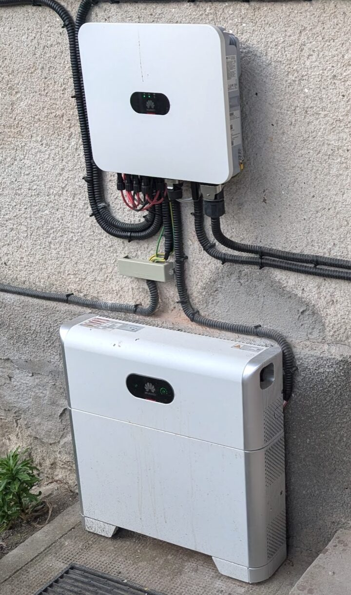
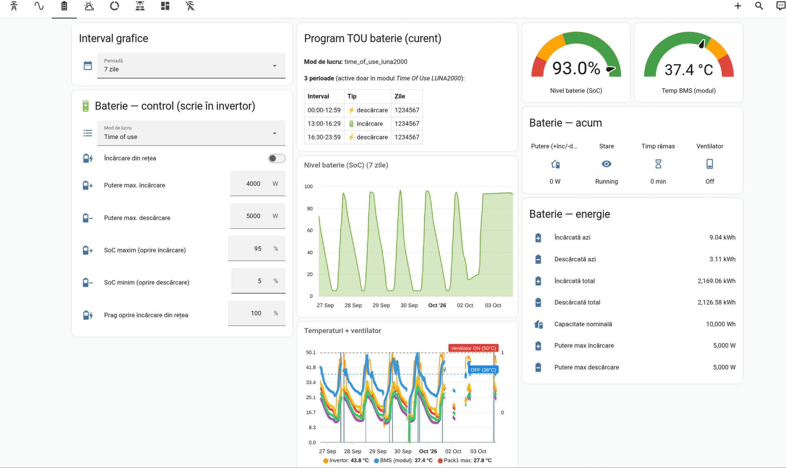
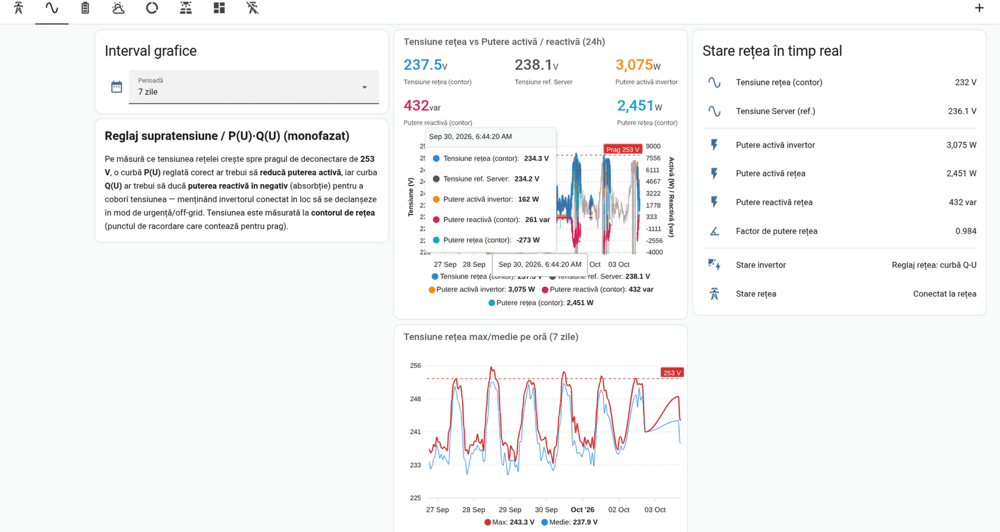

<!--
  Open: de overstap naar de UAP-Pro is uitgesteld. Zie de Engelse versie; houd beide
  talen gelijk als je iets toevoegt.
-->

Het huis in Roemenië heeft een Huawei SUN2000-8K-LC0 met een LUNA2000-batterij en 11,8 kWp
aan panelen. Huawei's cloud, FusionSolar, laat zien wat hij produceert, maar alleen als
gemiddelden per vijf minuten. Ik wilde live cijfers in Home Assistant, en op termijn de
batterij kunnen vertellen *wanneer* hij moet laden. Dat betekent Modbus-TCP, lokaal.



De normale route is Huawei's Smart Dongle, die Modbus op het thuisnetwerk aanbiedt. Deze
omvormer heeft er geen. Wat hij wel heeft, is een ingebouwd wifi-accesspoint, bedoeld voor de
telefoon van de installateur tijdens de inbedrijfstelling, en op dat netwerk luistert de
omvormer op poort **6607**. Ik wilde van dat accesspoint een vaste datalijn maken, en liep
tegen beperkingen aan die je pas ziet als je het echt probeert.

## Op het netwerk van de omvormer komen

Het accesspoint van de omvormer is een gesloten wereldje: de client krijgt een adres in
`192.168.8.0/24`, de omvormer zelf is `192.168.8.1`, en er is nergens anders een route
naartoe. Home Assistant draait in Docker op een Unraid-server in huis, op het gewone LAN.
Iets moet die twee verbinden.

Het voor de hand liggende plan is het plan waar elke netwerkengineer als eerste naar grijpt:
een wifi-stick in de server, verbinden met het accesspoint van de omvormer, en het LAN
erdoorheen NAT'en. Alles wat de omvormer wil bereiken stuurt pakketten naar `192.168.8.1`,
de server masqueradet ze via `wlan0`, klaar.

Het TCP-deel van dat plan werkt perfect. De SYN gaat eruit, de SYN-ACK komt terug, de
handshake is rond, en pings zitten stabiel op 2 ms. Daarna zegt de omvormer niets: elk
Modbus-verzoek wordt op TCP-niveau bevestigd en nooit beantwoord.

## Het protocol is Modbus, met een Huawei-login ervoor

Voordat ik het netwerk de schuld gaf, moest ik het protocol uitsluiten, want poort 6607 is
geen kale Modbus. Het gebruikt standaard Modbus-TCP-framing, maar op het wifi-accesspoint
weigert de omvormer elke registeruitlezing met een foutmelding totdat de client is ingelogd.
Die login is een Huawei-specifieke functiecode, `0x41`:

| stap | PDU | betekenis |
|------|-----|-----------|
| 1 | `41 24 01 00` | vraag een challenge van 16 bytes op |
| 2 | `41 25 <len> <client-challenge> <gebruiker> <digest>` | log in als `installer` |

De digest is `HMAC-SHA256(sleutel = SHA256(wachtwoord), bericht = challenge van de omvormer)`.
De uitstekende Python-bibliotheek [`huawei-solar`](https://github.com/wlcrs/huawei-solar-lib)
implementeert dit allemaal, en de Home Assistant-integratie gebruikt hem.

Met de juiste bibliotheek en het juiste wachtwoord had alles dus moeten werken. Via de NAT
werkte het niet: zelfs het opvragen van de challenge, elf bytes in totaal, liep elke keer in
een time-out.

## Geen NAT naar de omvormer

Wat uiteindelijk werkte, was NAT volledig uit het deel naar de omvormer halen. Ik gaf de
wifi-stick rechtstreeks door aan een VM, liet de VM zelf met het accesspoint verbinden, en
draaide de bibliotheek *op de machine die de wifi-verbinding had*. De login slaagde in één
keer, en elke registeruitlezing daarna ook.

Vanaf dat moment gold de regel: **de TCP-verbinding die de omvormer bereikt, moet beginnen op
het apparaat dat met zijn accesspoint verbonden is.** Alles wat verder weg zit, praat met een
*proxy* op dat apparaat, en die proxy opent een gloednieuwe eigen verbinding. De omvormer ziet
nooit een doorgestuurde of vertaalde verbinding.

Uit dezelfde tests kwam nog een tweede beperking: de omvormer antwoordde alleen een client op
**`192.168.8.2`**. Met een statisch `.199` waren de verbinding en TCP in orde, en toch bleef
hij net zo stil als via de NAT. Een deel van de mislukte NAT-proeven draaide vanaf een ander
adres, dus ik kan de twee effecten niet helemaal van elkaar scheiden. In de praktijk maakt dat
niet uit, want hetzelfde ontwerp voldoet aan allebei:

```
Home Assistant ──► proxy op het wifi-apparaat :6607
                     │  nieuwe TCP, bron 192.168.8.2
                     ▼
                   omvormer 192.168.8.1:6607
```

Vertaalde en doorgestuurde verbindingen kregen nooit antwoord, een verse socket vanaf `.2`
altijd, en ik ben gestopt met slim willen zijn.

## Ook de proxy moet inloggen

De eerste proxy was een `socat` van één regel. Home Assistant kon de omvormer nog steeds niet
toevoegen, en dat komt door de volgorde: tijdens het instellen leest de integratie de
modelnaam uit om te bepalen met wat voor apparaat hij praat, en dat doet hij *voordat* hij
inlogt. Deze omvormer weigert die uitlezing, dus de detectie faalt en het instellen breekt af.

De oplossing was de proxy zelf te laten inloggen. Voor elke binnenkomende verbinding opent hij
een nieuwe TCP-verbinding naar de omvormer, doet de `0x41`-challenge en de login, en begint
pas daarna bytes in beide richtingen door te geven. Home Assistant krijgt een sessie die al
geauthenticeerd is, dus detectie en uitlezen werken. De sessie heeft installateursrechten, dus
schrijven (batterijmodi, laad- en ontlaadschema's) werkt ook. De proxy is minder dan honderd
regels `asyncio`, en een shell-lus herstart hem als hij ooit stopt.

## Beperkingen die we onderweg tegenkwamen

### Eén Modbus-sessie, in totaal

De omvormer bedient precies één Modbus-client tegelijk. Zolang Home Assistant de sessie heeft,
wordt een tweede client (een testscript, of de FusionSolar-app op een telefoon aan hetzelfde
accesspoint) geweigerd, of gooit hij Home Assistant eraf. De integratie logt dan *"the
inverter only supports one Modbus connection at a time"*. Die waarschuwing verschijnt bij elke
onderbroken uitlezing, dus het is een aanwijzing, en de echte oorzaak moet je nog zelf vinden.

### De netwerkscripts van de host willen die interface hebben

Unraid's eigen wifi-scripts starten een DHCP-client op elke wifi-interface. Het accesspoint
van de omvormer beantwoordt DHCP niet zoals die client verwacht, dus hij geeft het op, kent
een link-local `169.254.x.x`-adres toe, en het statische `192.168.8.2` is weg. Ik heb het
opgelost met een klein bewakingsscript dat `wlan0` buiten de configuratie van de DHCP-daemon
houdt en het adres terugzet als iets het weghaalt. (Wat je ook doet: draai op die machine
nooit met de hand `dhcpcd` tegen `wlan0`. Die beheert de hoofdbridge, en zo heb ik de hele
server een keer van het netwerk gehaald.)

### Een USB-wifi-stick is een zwakke radio

De goedkope 2,4 GHz-stick in de server zat op slechte dagen tussen −67 en −73 dBm. Genoeg om
te verbinden, te weinig om verbonden te blijven. Vanuit Home Assistant ziet een wegvallende
verbinding er precies zo uit als een Modbus-storing, dus het eerste wat je controleert is
altijd de radio: `iw dev wlan0 link`.

### De Modbus-kant kan uit zichzelf vastlopen, en een herstart helpt misschien niet

De meest verwarrende storing ziet er in een pakketopname zo uit: de verbinding gaat open, het
login-verzoek van elf bytes gaat eruit, de omvormer *bevestigt het op TCP-niveau*, en daarna
komt er nooit antwoord. Zelfs een gewone registeruitlezing zonder login krijgt niet de
gebruikelijke "log eerst in"-foutmelding terug; de Modbus-kant is volledig stil. Dat herhaalt
zich urenlang elke vijftien seconden. De wifi is in orde, pings zijn in orde, DHCP geeft de
stick nog steeds zijn `192.168.8.2`, en er is geen andere client. Om zeker te weten dat het
niet aan mijn kant lag, probeerde ik elke route naar de omvormer naast elkaar: een kale
socket, de `socat`-forwarder en de login-proxy. Ze liepen allemaal precies zo in een
time-out, dus wat er mis was, zat op `192.168.8.1`.

Mijn eerste ingeving was de omvormer herstarten, en juist daar verloor ik de meeste tijd. Via
de app uit en weer aan zetten deed niets. Dat zag je eraan dat de wifi-client van de server
niet opnieuw verbond: het communicatiebord was al die tijd aan gebleven. Dus ging ik verder,
met een volledige koude uitschakeling: AC en DC losgekoppeld *en beide batterijen uit*, een
paar minuten lang. Nu herstartte het bord echt (`wlan0` viel weg en kwam terug), en Modbus
was *nog steeds* stil.

Uiteindelijk was het geen herstart die het terugbracht. Ik verbond met een telefoon met de
eigen `SUN2000-…`-wifi van de omvormer en logde in op de SUN2000-app. Op het moment dat die
beheersessie tot stand kwam, begon Modbus te antwoorden: eerst met de "log eerst
in"-foutmelding die het had achtergehouden, en daarna, via de proxy, met een schone
installateurslogin en live data in Home Assistant.

Het lokale scherm van de SUN2000-app praat dus met de omvormer via Huawei's eigen
beheerprotocol, niet via Modbus. Als de app lokaal werkt, weet je dat het bord gezond is; over
Modbus-TCP zegt het niets. En als Modbus volledig stil is gevallen, maakt een lokale
beheerlogin via de app het wakker. Een stroomcyclus doet dat niet. Gebeurt het opnieuw, dan
log ik één keer in op de app en herstelt Home Assistant vanzelf.

## Waar de verbinding voor is

Met de sessie op zijn plek is Home Assistant meer dan een scherm om naar te kijken. De
proxy logt in met installateursrechten, dus dezelfde Modbus-verbinding schrijft ook
instellingen terug naar de omvormer.

De batterij is het voor de hand liggende voorbeeld. Vanuit één dashboard stel ik de
werkmodus in (bij mij time of use), of de batterij uit het net mag laden, het maximale laad-
en ontlaadvermogen, de laadtoestand waarop laden en ontladen stoppen, en het
time-of-use-schema zelf. Het schema hieronder ontlaadt 's nachts en 's ochtends, laadt
tussen 13:00 en 16:30, en ontlaadt 's avonds weer.



Minder voor de hand liggend is het blindvermogen. De omvormer schakelt af als de
netspanning op het aansluitpunt 253 V bereikt. Het net hier is overbelast, en rond het
middaguur kruipt de spanning bij mijn meter de meeste dagen naar die grens toe; het
maximum per uur raakte hem deze ene week een paar keer. Voordat het zover is, hoort een
P(U)-curve het werkelijk vermogen terug te schroeven en een Q(U)-curve de omvormer
blindvermogen te laten opnemen. Dat drukt de spanning omlaag en houdt de omvormer aan het
net, in plaats van dat hij in een noodstop schiet. Beide curves zijn instellingen van de
omvormer, dus ik kan ze vanuit Home Assistant afstellen en het effect op hetzelfde scherm
volgen.



Dit via de eigen wifi van de omvormer doen heeft een prijs, en de screenshots laten die
zien. De verbinding met het accesspoint is niet altijd betrouwbaar, en als die wegvalt,
valt de data ook weg: de temperatuurgrafiek heeft gaten rond 2 en 3 oktober, en de lijn
van de laadtoestand trekt gewoon een rechte streep van het laatste punt voor het gat naar
het eerste erna. Een Smart Dongle op het thuisnetwerk zou waarschijnlijk stabieler zijn.
Voorlopig koop ik er geen, want wat ik nu heb is voor mij stabiel genoeg.

## Volgende stap: laat een accesspoint het doen

Dit alles draait op een server met een USB-stick eraan, en dat is de zwakste schakel. Het
huis heeft drie oude UniFi-accesspoints van de eerste generatie, die onlangs naar OpenWrt zijn
overgezet en met OpenWISP worden beheerd. In een eerste test ving een ervan, een UAP-Pro, de
omvormer op met −56 dBm, tegen −63 dBm voor de USB-stick op een goede dag, dus het plan is de
verbinding met de omvormer daarheen te verhuizen.

De geen-NAT-regel bepaalt hoe. Het accesspoint als client laten verbinden en het LAN
erdoorheen masqueraden is precies de opzet die nooit antwoord kreeg, dus het accesspoint
krijgt dezelfde behandeling als de server:

- de 2,4 GHz-radio verbindt als station met de omvormer, met een statisch `192.168.8.2` en
  **geen gateway en geen DNS** op die interface, zodat niets aan de kant van de omvormer ooit
  de standaardroute van het accesspoint kan overnemen;
- een `socat` op het accesspoint luistert op zijn LAN-adres, accepteert alleen de Home
  Assistant-server, en opent een verse verbinding naar `192.168.8.1:6607`, *gebonden aan*
  `192.168.8.2`;
- de login-proxy op de server wijst gewoon naar het accesspoint in plaats van naar
  `192.168.8.1`.

Er is geen forwarding en geen masquerade; `ip_forward` blijft uit. De omvormer ziet nog
steeds precies één verse TCP-verbinding vanaf `.2`.

Eén OpenWrt-detail bleek belangrijker dan ik had verwacht. Een radio kan tegelijk een
accesspoint en een station bedienen, maar het accesspoint volgt het station: zodra het station
zijn verbinding verliest, gaat het accesspoint op die radio mee onderuit. Het accesspoint van
de omvormer is niet bepaald betrouwbaar, dus met een gedeelde radio zou de wifi van het huis
op dat accesspoint knipperen telkens als die van de omvormer dat deed. Die 2,4 GHz-radio is
daarom helemaal voor de omvormer, en de 5 GHz-radio en de andere twee accesspoints bedienen
het huis.

De overstap heb ik voorlopig uitgesteld, dus de USB-stick doet het werk nog steeds.

## Wat ik mezelf aan het begin had willen vertellen

- Heeft de omvormer geen Smart Dongle, dan is poort 6607 op zijn eigen wifi echte Modbus-TCP,
  met een verplichte installateurslogin.
- NAT nooit het deel dat de omvormer bereikt. Gebruik een proxy, en begin vanaf
  `192.168.8.2`.
- Reken op één Modbus-sessie. Alles wat verder verbinding maakt, kost je data.
- Een ACK op TCP-niveau zonder Modbus-antwoord betekent dat het probleem bij de omvormer zit,
  niet bij je netwerk. Controleer of de wifi-verbinding je "herstart" heeft overleefd voordat
  je erop vertrouwt.
- Valt Modbus *volledig* stil (geen antwoord, zelfs niet op een uitlezing zonder login), dan
  brengt een stroomcyclus het misschien niet terug. Een lokale login via de SUN2000-app wel,
  want dat is een ander protocol dat de beheerkant wakker maakt. "De app werkt" is geen bewijs
  dat Modbus aanstaat.
