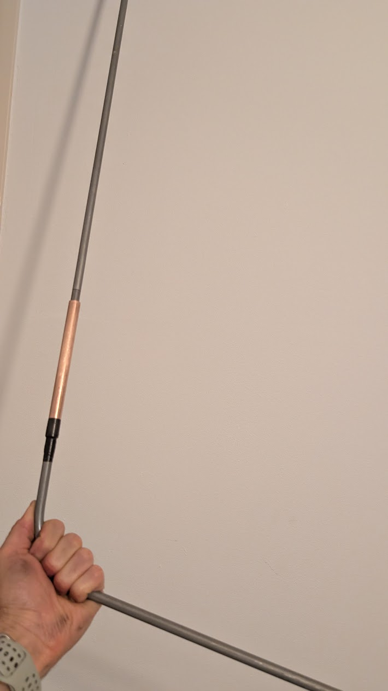
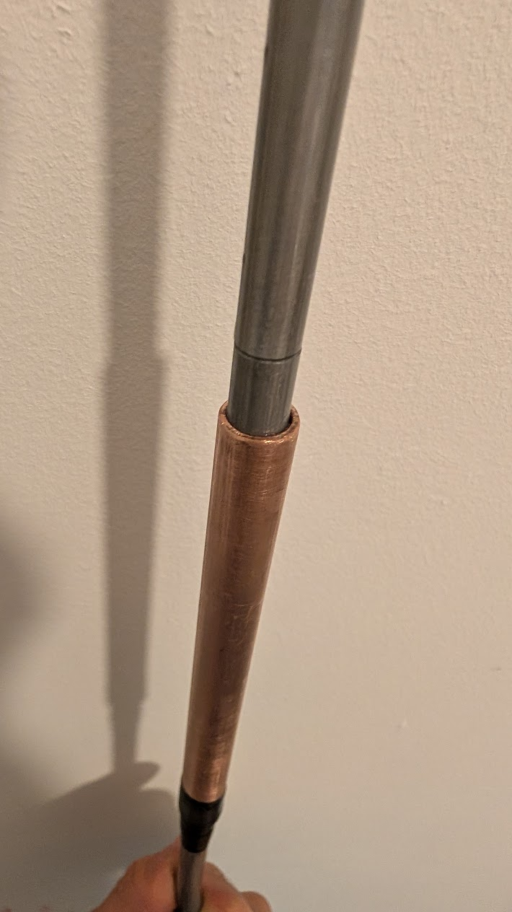

<!-- Notele CONFIRM/TODO sunt în en.md; ține cele trei limbi la fel când adaugi ceva. -->

## Ce s-a rupt

Bicicleta noastră cargo (bakfiets), un Lovens Explorer, are un set de tuburi subțiri de
aluminiu care țin cortul de ploaie. Sunt ușoare, se flexează și se îmbină cu aceleași
mufe în care tuburile intră unul în altul, ca la un cort de camping. Unul dintre ale
noastre s-a rupt de tot, chiar deasupra curburii de jos.

Un tub de aluminiu cu pereți subțiri, rupt așa, nu mai are rost să-l lipești. Cele două
capete nu mai stau drept unul în fața celuilalt, iar fiecare rafală de vânt trage de
îmbinare. Rămâneau două variante: o piesă nouă sau o atelă peste ruptură.

## De ce nu am comandat pur și simplu piesa?

N-aveam chef să aștept. O piesă de schimb înseamnă să găsesc dealerul potrivit, să aștept
termenul de livrare și să plătesc pentru ceva ce e, de fapt, un metru de tub. Între timp
cortul stă jos și plouă.

## Manșonul

Peste un tub rupt pui o atelă pe exterior, cam cea mai veche reparație care există.
Manșonul preia efortul de încovoiere, așa că aluminiul din interior trebuie doar să stea
pe loc.

Îmi rămăsese o bucată de **țeavă de cupru de 12 mm** de la o lucrare de instalații.
Țeava standard de cupru de 12 mm are peretele de 1 mm, deci 10 mm la interior, iar tubul
de aluminiu are în jur de 10 mm. Intră peste el aproape fără joc: destul de strâns ca să
nu zdrăngăne și destul de larg ca să-l montezi fără ciocan.

1. Taie o bucată de țeavă de cupru de vreo 20 cm. Cu un dispozitiv de tăiat țevi obții o
   margine curată, dar merge și cu un fierăstrău pentru metal. Debavurează marginea
   interioară cu o pilă rotundă sau cu muchia de pe spatele unui cuțit, altfel zgârie
   aluminiul când îl împingi peste el.
2. Curăță cele două capete rupte ale tubului de aluminiu și scoate-le bavurile, ca să
   alunece în cupru fără să se agațe.
3. Împinge manșonul peste o jumătate, apoi bagă cealaltă jumătate prin capătul opus până
   când ruptura ajunge cam la mijlocul țevii de cupru.
4. Înfășoară câteva spire de bandă izolatoare acolo unde cuprul se întâlnește cu
   aluminiul, la capătul de jos. Banda împiedică manșonul să alunece în jos pe tub și
   acoperă marginea, ca să nu roadă pânza cortului.

## Despre cupru în contact cu aluminiu

Dacă faci și tu la fel, să știi că cuprul și aluminiul care se ating în prezența umezelii
formează un cuplu galvanic, iar aluminiul e cel care se corodează. La un arc de cort care
stă sub o husă de pânză și se usucă între averse, asta nu mă îngrijorează. La o piesă
care stă udă tot anul, cum ar fi un element de cadru sau orice e lângă roți, aș folosi
în schimb un manșon din inox sau din aluminiu, sau măcar aș pune un strat de bandă între
cele două metale.

E o atelă pentru un arc de cort. N-aș face asta la nimic care ține de direcție sau de
frâne, nici la ce îi duce pe copii.

## Ține?

Deocamdată, da. Îmbinarea e mai rigidă decât tubul original, așa că arcul acela se
flexează puțin mai puțin decât cel din partea cealaltă. Odată ce pui pânza, nu se mai
observă. N-a costat nimic, pentru că aveam deja totul prin casă, și mi-a luat mult sub o
jumătate de oră, cea mai mare parte cu pila.

## Piese și scule

| Ce | Notă |
| --- | --- |
| Țeavă de cupru, 12 mm, ~20 cm | rămasă de la o lucrare de instalații; orice magazin de bricolaj o vinde la metru |
| Bandă izolatoare | câteva spire |
| Dispozitiv de tăiat țevi sau fierăstrău pentru metal | |
| Pilă rotundă mică | pentru debavurarea ambelor metale |
