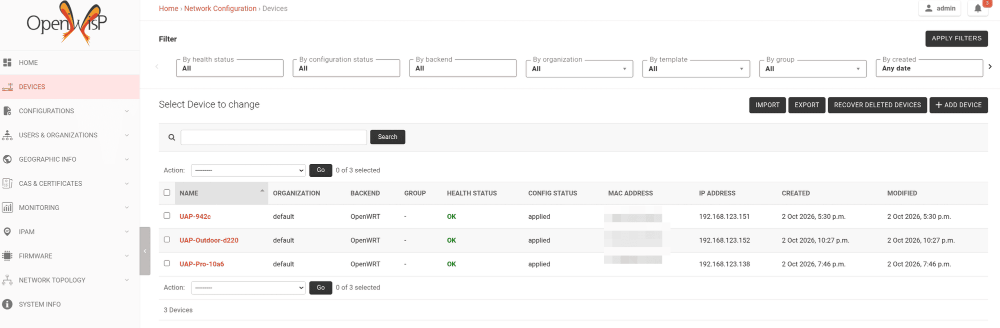

The house in Romania runs on three first-generation UniFi access points: a UAP, a
UAP-Pro and a UAP-Outdoor+. The hardware is fine, but Ubiquiti stopped at firmware
4.3.28.11361 in February 2021 and declared them end-of-life a month later. The last
controller that still adopts them is 6.0.45, which is itself years old. That leaves the
usual choice for old gear that still works: landfill, or a current operating system. I
flashed all three to OpenWrt 25.12 and put them under one self-hosted OpenWISP.

, CC0, via Wikimedia Commons.")

## The three access points

| Model | SoC | Flash / RAM | Band(s) |
|-------|-----|-------------|---------|
| UAP (BZ2) | Atheros AR7241 | 8 MB / 60 MB | 2.4 GHz |
| UAP-Pro (U7P) | Atheros AR9344 | 16 MB / 125 MB | 2.4 + 5 GHz |
| UAP-Outdoor+ (U2HSR) | Atheros AR7241 | 16 MB / 60 MB | 2.4 GHz |

All three are supported ath79 targets in OpenWrt. Without that, this would have been a
reverse-engineering project instead of a weekend one.

## Why you cannot just flash them

Every guide says to put the OpenWrt factory image onto the AP
with TFTP recovery or Ubiquiti's own `fwupdate.real`. On these APs, at this firmware,
both refuse it, for two reasons:

- Stock firmware from 4.0.15 onwards dropped the `rootfs` partition. The layout is
  just u-boot, its environment, a single `kernel` (or `jffs2`) partition, config and the
  radio EEPROM, and the tools expect a partition that is not there.
- U-boot checks the RSA signature trailer (`ENDS`) that Ubiquiti appends to its own
  images. OpenWrt's image does not have it, so TFTP recovery and `fwupdate` reject it as
  not a valid UBNT image.

What does work is writing the OpenWrt sysupgrade image straight into the kernel
partition with OpenWrt's *own* `mtd` tool, because the stock busybox `mtd` is too old.
I copied the sysupgrade image and a statically-usable `mtd` binary onto the AP (the
binary is pulled out of the built OpenWrt rootfs and run through its musl loader), then:

```
mtd -e kernel write /tmp/openwrt.bin kernel     # BZ2
mtd -e jffs2  write /tmp/openwrt.bin jffs2      # Pro and Outdoor+
```

The stock u-boot still runs `ubntappinit; ubntboot`, and that quite happily boots the
OpenWrt uImage that now sits where the kernel used to be. If it had not, the recovery is
a TFTP of the stock image with reset held at power-on (the AP listens at 192.168.1.20).
I had a 3.3 V USB-serial adapter on the bench the whole time and never needed it.

## Building the image

I did not want to take the generic download and configure each AP by hand, so I built
an image per model with OpenWrt's ImageBuilder (the official `ath79-generic-25.12.5`
container). A freshly flashed AP comes up already configured and already talking to
OpenWISP.

These are dumb access points, so most of OpenWrt comes out:

```
-dnsmasq -firewall4 -nftables -odhcpd -ppp ...
+wpad-mbedtls +usteer +iwinfo +openwisp-config +openwisp-monitoring
```

`usteer` is the interesting addition. It does 802.11k/v steering, so a client walking
through the house gets nudged to the nearest AP instead of clinging to the first one it
saw. It needs the full `wpad-mbedtls`, not the `-basic` build, because only the full one
has the 802.11v (`WNM`) code compiled in. Miss that and you lose an afternoon.

The config is baked in as a first-boot `uci-defaults` script: hostname, radio channel,
the `Fritzi` SSID and its key, 802.11k/v on, the SSH keys and a root-password fallback.
The script is generated per AP from that AP's own captured settings, so the WiFi
password never gets typed anywhere.

## The flash itself, and what it taught me

Three things that are obvious in hindsight:

- **A backgrounded `mtd write` dies the instant the SSH session closes.** The first run
  looked like it worked and had done nothing: the kernel partition was untouched, with
  its magic bytes intact. Wrapping the write as `( trap "" HUP; mtd … ) & wait` so it
  ignores `HUP` fixed it. Verify with a read-back of exactly the image's length, not a
  rounded block count, or you get a false mismatch and a needless scare.
- **The Outdoor+ comes back on a different MAC.** OpenWrt bridges both Ethernet ports and
  takes the second port's address, so the AP that was `80:…:d2:20` on the network is now
  `82:…:d2:20`. I spent a few minutes convinced it had not booted before I looked for the
  right neighbour.
- **Check the image is for the board before you write it.** When I derived the Pro's
  flash script from the BZ2's, it kept the BZ2 image path, and the dry run happily staged
  a UAP image onto the Pro. That would have bricked it. Both scripts now read the
  sysupgrade metadata and refuse to write unless it names the board they are pointed at.

The Outdoor+ also needed its transmit power capped to 10 dBm. Its antenna and amplifier
add 10 to 11 dB and the EU limit on 2.4 GHz is 20 dBm, so OpenWrt's default would have
put it well over.

## What OpenWISP adds

OpenWrt on its own would mean SSHing into three APs one at a time.
[OpenWISP](https://openwisp.org) is the other half: a self-hosted controller, running in
Docker on the house server, that manages them as a fleet.



- It gives one dashboard for three different models. The old UniFi controller only ever
  spoke to UniFi hardware and was itself frozen at a 2021 release. OpenWISP does not care
  what the device is, only that it runs the agent.
- Each AP reports its associated WiFi clients, interface traffic, load, memory, disk,
  neighbours and uptime, with charts over time. This is the part you miss immediately
  when you leave a vendor controller.
- Config templates are written once and pushed to every AP. `merge_config` keeps each
  device's own bits, and `test_config` applies a change, checks the AP is still
  reachable, and rolls back automatically if a bad push would otherwise have locked you
  out. The agent polls every two minutes.
- SSH keys are distributed by a template, and image upgrades run from the same dashboard
  instead of three manual `sysupgrade`s.
- With `usteer` on each AP, the APs coordinate roaming between themselves. Right after
  the flash, the UAP had already found the Pro as a steering peer on its own, so clients
  move between the three APs on one SSID.

Because the whole stack is open source, I could fix a gap myself. OpenWISP's
WiFi-session view listed clients only by MAC address, and the data to show a hostname
and IP was not there. I added it with a small DHCP/ARP snooper on the APs and a couple
of fields on the server, and pushed it as branches against the relevant
[upstream issue](https://github.com/openwisp/openwisp-monitoring/issues/629). With a
sealed appliance I would have filed a request and waited.

 moved from UAP-942c to the Pro on 3 October. MAC addresses blurred.")

## What I would tell myself at the start

- First-gen UniFi APs are standard ath79 OpenWrt targets, but at stock 4.x you flash them
  with `mtd`, not TFTP or `fwupdate`, because there is no `rootfs` partition and u-boot
  checks Ubiquiti's signature.
- Build per-model images with ImageBuilder so a flashed AP configures itself and joins
  the controller. Do not hand-configure three boxes.
- `usteer` needs the full `wpad-mbedtls` for 802.11v, and the Outdoor+'s TX power needs
  capping for EU limits.
- OpenWISP is the reason to do any of this. It gives central config with automatic
  rollback, real monitoring, fleet-wide roaming and firmware upgrades, self-hosted and
  without a licence, on hardware the vendor had already written off.
